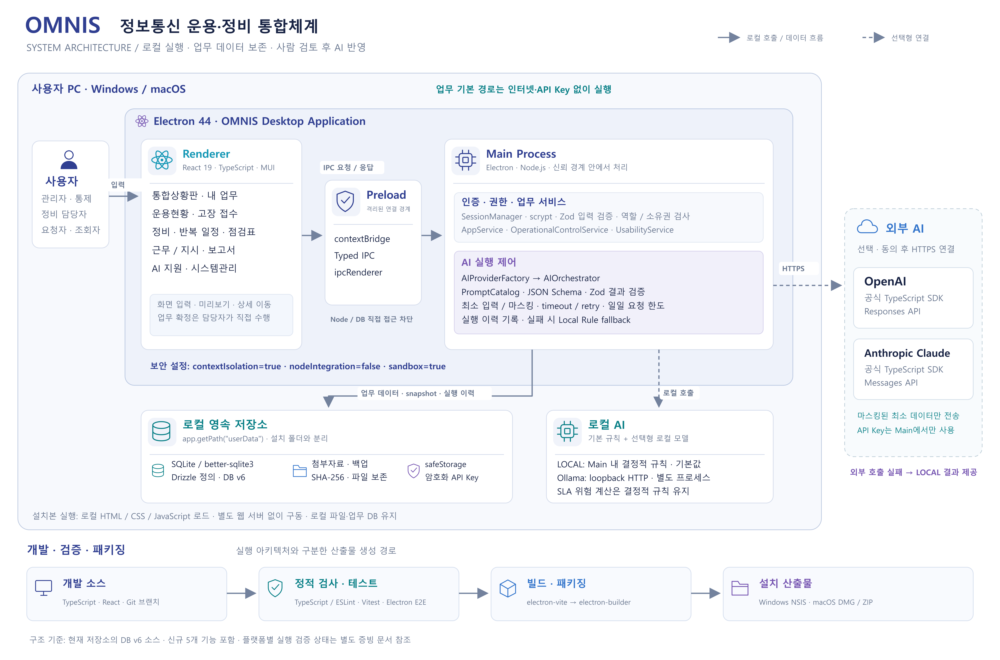
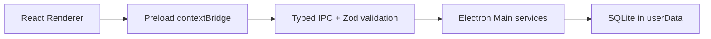
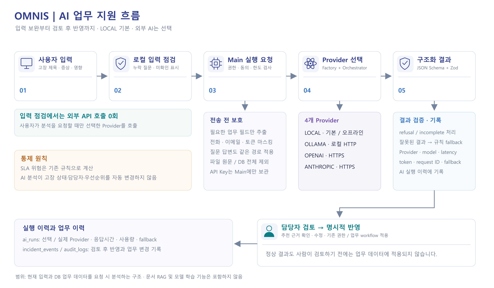

# Architecture

고해상도 구성도와 수정 가능한 SVG는 [시스템 구성도](architecture/README.md)를 참고한다.

Renderer는 Node와 SQLite에 직접 접근하지 않습니다. 단일 인스턴스, 외부 탐색 차단, context isolation, sandbox, CSP를 적용합니다.

## 업무 확장과 데이터

`UsabilityService`는 접수 템플릿·보완정보, 개인 업무, 작업별 체크리스트 snapshot, 반복 정비 규칙·발생 회차를 처리한다. 입력 계약은 `shared/usabilityContracts.ts`, 날짜 계산과 로컬 입력 점검은 `shared/usability.ts`에 있다. 기존 업무 상태 전이와 완료 결과 검증을 재사용하고 점검표가 연결된 정비에만 추가 완료 조건을 적용한다.

DB v6는 기존 v1~v5를 보존하는 순방향 migration이다. 템플릿 변경과 이미 생성된 업무의 snapshot을 분리하고 반복 규칙/원래 발생 예정일의 유일성을 보장한다. `work:mine`은 중복 저장소 없이 현재 로그인 사용자로 기존 테이블을 조회한다.

## AI 경계

입력 보완은 로컬 규칙이며 외부 API를 호출하지 않는다. 사용자가 분석을 요청하면 기존 Factory/Orchestrator와 Provider가 최소화·마스킹된 입력을 처리한다. API Key는 Main의 safeStorage 또는 환경변수에서만 읽고 renderer에는 masked 상태만 제공한다. SLA 위험 계산은 결정적 규칙이다.

