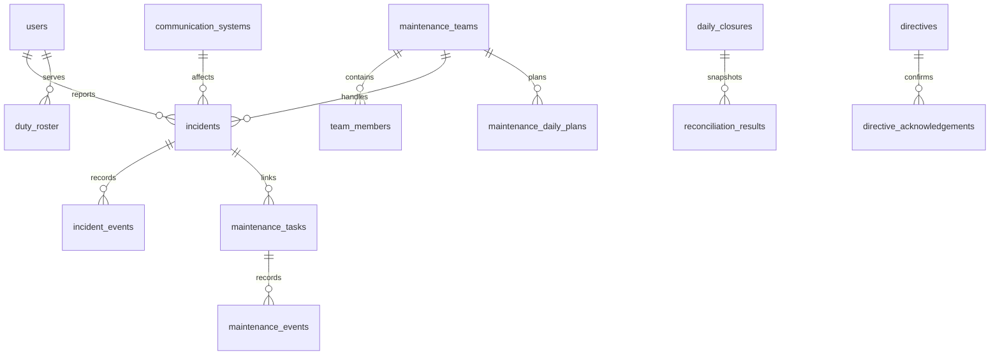

# Database

SQLite DB는 설치 폴더 밖의 `%APPDATA%/OMNIS/data/omnis.db`에 있다. `PRAGMA user_version` 기반 schema v4 migration을 transaction으로 적용하며 v2 기존 행 보존을 integration test로 검증한다. 첨부파일은 `%APPDATA%/OMNIS/attachments`에 저장하고 `attachments` 테이블에는 업무 연결, 원본명, 분류, MIME, 크기, SHA-256, 등록자와 시각을 기록한다. DB 백업 시 같은 시점의 첨부 폴더도 `%APPDATA%/OMNIS/backups`에 복사하며 최근 10개 세트를 유지한다.

## v3 주요 변경

- `incidents`: 접수수단, 서비스 영향, 발생/희망시각, 정비반, 원격/현장, 긴급 선조치, SLA, 검증, 재발위험, AI 근거.
- `maintenance_tasks`: 고장 연결, 계획/비계획, 원인·상세조치·부품·방식·재발·후속점검.
- 신규: `maintenance_teams`, `team_members`, `situation_alerts`, `maintenance_daily_plans`, `reconciliation_results`, `daily_closures`, `handover_notes`, `directive_acknowledgements`, `ai_runs`, `demo_scenarios`.
- v4: `attachments`와 업무별 조회·해시 인덱스. 실행파일은 첨부할 수 없고 이미지·PDF·문서·표·텍스트·로그·ZIP만 허용한다.
- 인덱스: 팀/상태, SLA, 접수일/상태/긴급도, 정비 예정일/상태/구분, 경보 상태, 일일계획, 대조결과, 인수인계, AI 실행.

Demo Mode 초기화는 `demo_scenarios.entity_ids_json`에 기록된 생성 행만 지우며 일반 사용자 데이터는 유지한다.
