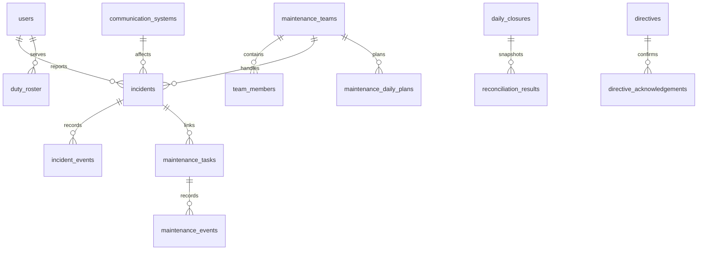

# Database

SQLite DB는 설치 폴더 밖의 `%APPDATA%/OMNIS/data/omnis.db`에 있다. `PRAGMA user_version` 기반 schema v6 migration을 transaction으로 적용하며 v2 기존 행 보존을 integration test로 검증한다. 첨부파일은 `%APPDATA%/OMNIS/attachments`에 저장하고 `attachments` 테이블에는 업무 연결, 원본명, 분류, MIME, 크기, SHA-256, 등록자와 시각을 기록한다. DB 백업 시 같은 시점의 첨부 폴더도 `%APPDATA%/OMNIS/backups`에 복사하며 최근 10개 세트를 유지한다.

## v3 주요 변경

- `incidents`: 접수수단, 서비스 영향, 발생/희망시각, 정비반, 원격/현장, 긴급 선조치, SLA, 검증, 재발위험, AI 근거.
- `maintenance_tasks`: 고장 연결, 계획/비계획, 원인·상세조치·부품·방식·재발·후속점검.
- 신규: `maintenance_teams`, `team_members`, `situation_alerts`, `maintenance_daily_plans`, `reconciliation_results`, `daily_closures`, `handover_notes`, `directive_acknowledgements`, `ai_runs`, `demo_scenarios`.
- v4: `attachments`와 업무별 조회·해시 인덱스. 실행파일은 첨부할 수 없고 이미지·PDF·문서·표·텍스트·로그·ZIP만 허용한다.
- 인덱스: 팀/상태, SLA, 접수일/상태/긴급도, 정비 예정일/상태/구분, 경보 상태, 일일계획, 대조결과, 인수인계, AI 실행.

Demo Mode 초기화는 `demo_scenarios.entity_ids_json`에 기록된 생성 행만 지우며 일반 사용자 데이터는 유지한다.

## v6 실용 기능

`work_templates`: 고장 접수/점검표 정의, 활성 상태, version. 최초 migration에서 기본 6종 접수 템플릿과 4종 점검표를 등록하며 seed 재실행이 사용자 수정을 덮어쓰지 않는다.

`incident_intakes`: 접수당 템플릿 ID/version·질문 문구·구조화 답변 snapshot. 기존 접수에는 소급 생성하지 않는다.

`task_checklists`: 작업당 항목·필수/NA 정책 snapshot, 결과·수행자·시각, optimistic revision. 완료 시 Main transaction에서 필수 조건을 검사한다.

`recurring_rules`: 소유자, version, 활성/삭제 상태, 반복 정의. `recurring_occurrences`는 `(rule_id, occurrence_date)`를 primary key로 하고 원래 발생일과 실제 task 예정일을 분리한다. task가 삭제되어도 발생 회차 tombstone은 남아 자동 재생성을 막는다.

신규 테이블은 전체 DB 백업에 포함된다. API Key 저장소는 포함하지 않는다. 과거 데이터와 v5 AI 사용량·Provider 설정도 보존된다.

## v7 조치부서 디렉터리

`organization_units`: 실제 부대명·부대급·공개 출처와 자료 기준일. 부대만 확인한 경우에도 행은 존재하며 가상의 내부 부서를 만들지 않는다.

`team_organizations`: 기존 `maintenance_teams`와 부대의 연결, 부서 명칭·출처·자료 기준일·PUBLIC/LOCAL 등록 기준·메모. 부대/부서명 조합은 유일하다. seed는 관리자 수정과 비활성 상태를 보존한다.

`incidents.department`는 요청부서이며 배정 시 변경하지 않는다. 조치부서는 `team_id`로 조회하고 NULL이면 미지정으로 표시한다. v7 migration은 기존 요청부서·배정 행을 추정 수정하지 않는다. 기존 유선·무선·사이버 정비반 코드와 AI 계약을 유지한다.
