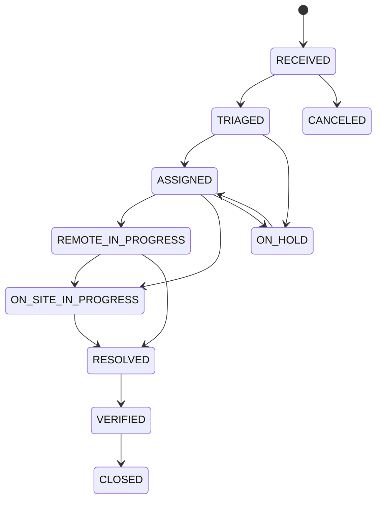

# 고장·정비 Workflow 명세

## 고장 상태

호환성을 위해 기존 `PLANNED`, `IN_PROGRESS` 상태를 읽고 신규 상태로 전환할 수 있다. 모든 전이는 `assertTransition`으로 Main Process에서 검증한다.

## 전이 불변조건

- `RESOLVED`: 원인과 조치결과 필수.
- `CLOSED`: 요청 사용자 확인 필수.
- 긴급 선조치 접수: 사유와 실제 조치 시작시각 필수.
- MAINTAINER: 본인 배정 또는 소속 정비반 작업만 전이 가능.
- USER: 본인 접수만 보며 `VERIFIED → CLOSED` 사용자 확인만 수행.
- 실패한 검증과 전이는 transaction 시작 전에 또는 transaction 내부에서 예외 처리되어 부분 저장하지 않는다.

## 정비 상태

`PLANNED → IN_PROGRESS ↔ BLOCKED → COMPLETED`, 어느 진행 상태에서나 정책상 `CANCELED` 전이가 가능하다. 완료 시 원인, 상세조치, 결과, 원격/현장 방식이 필수이고 완료율은 100으로 고정된다.

## 정합성 검사

- 해결/검증/종결된 고장에 조치결과가 없는 경우.
- 연결 정비가 완료됐지만 고장이 해결 상태가 아닌 경우.
- 작업 총계보다 완료가 적지만 미완료 사유가 없는 경우.
- ADMIN 예외 마감은 발견 항목과 예외 수를 snapshot에 보존한다.

## 감사 이벤트

상태 전이, 정비반/담당자 지정, AI 반영, 경보 확인/종료, 계획 변경, 마감, 인수인계 확정, Demo 생성/초기화가 `audit_logs` 또는 세부 event table에 기록된다.
