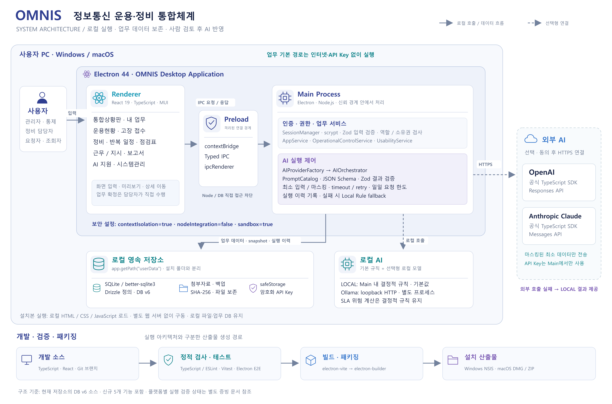
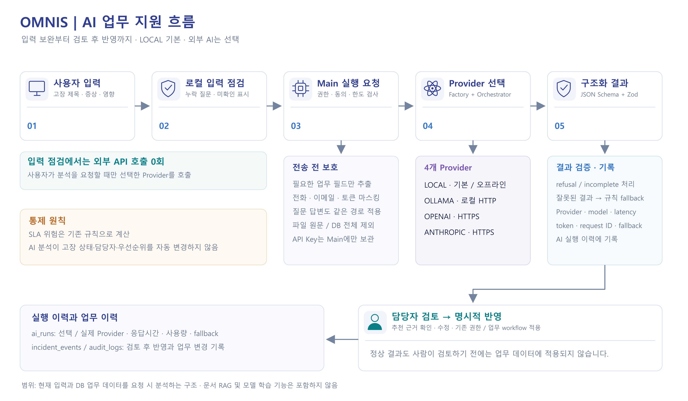

# OMNIS 시스템 구성도

현재 Electron 애플리케이션 소스의 실행 경계와 데이터 흐름을 기준으로 작성했다. 참고 이미지의 배치 방식은 활용하되 OMNIS에서 사용하지 않는 클라우드 서버·DB·프록시는 구성요소에 포함하지 않는다.

## 전체 시스템

- PNG: 5,600 × 3,700 px, 발표·기술서 삽입용.
- SVG: `omnis-system-architecture.svg`, 글자와 도형을 수정할 수 있는 벡터 원본.
- 사용자 PC 안의 Electron Renderer → Preload → IPC → Main 업무 서비스 → 로컬 DB/파일 저장 흐름.
- Zod 입력 검증과 권한 검사는 Main의 IPC/서비스에서 수행한다.
- LOCAL 규칙은 Main에서 실행하며 Ollama는 선택형 별도 로컬 프로세스다.
- OpenAI/Anthropic은 외부 전송 동의와 설정 후 Main에서만 HTTPS로 호출한다.
- 개발·검증·패키징 흐름은 하단에 실행 경로와 구분하여 표시했다.

## AI 업무 지원

- PNG: 4,800 × 2,800 px.
- SVG: `omnis-ai-data-flow.svg`.
- 입력 보완의 로컬 규칙과 사용자가 요청한 AI 분석을 구분한다.
- Main 권한/설정 검사, 데이터 최소화·마스킹, Provider 선택, 구조화 응답 검증, 실행 이력과 담당자 검토 후 반영을 표시한다.
- RAG와 문서 학습은 포함하지 않는다.

## 기준과 검증 범위

DB v6와 신규 실용 기능 5종의 소스 구조를 포함한다. 다이어그램은 배포 시험 성적서가 아니다. 신규 기능의 테스트·패키징 상태와 기존 macOS CI 결과는 각각 해당 버전의 검증 문서를 확인해야 한다. 실제 군 운용 검증이나 클라우드 실시간 다중 PC 동기화를 의미하지 않는다.

| 그림의 구성요소 | 확인한 소스 |
|---|---|
| Electron 경계·보안 설정 | `src/main/index.ts` |
| Preload 연결·공유 계약 | `src/preload/index.ts`, `src/shared/contracts.ts` |
| 로그인·역할·업무 | `src/main/auth/SessionManager.ts`, `src/main/services/AppService.ts` |
| 통제·신규 실용 기능 | `src/main/services/OperationalControlService.ts`, `UsabilityService.ts` |
| AI 선택·실행·응답 검증 | `src/main/ai/AIProviderFactory.ts`, `AIOrchestrator.ts`, `PromptCatalog.ts` |
| 전송 최소화·Key 보호 | `src/main/ai/ExternalDataGuard.ts`, `AISecretStore.ts` |
| DB·첨부 보존 | `src/main/database/migrate.ts`, `schema.ts`, `src/main/services/AttachmentStore.ts` |
| 검증·패키징 | `package.json`, `tests/`, `electron-builder.yml` |

최종 Windows 실행본과 테스트 결과는 [검증 기록](../FIVE_FEATURES_VERIFICATION.md)에 있다. 위의 짧은 파일명은 같은 행에 먼저 명시한 디렉터리를 기준으로 한다.

## 수정

`python scripts/draw-architecture.py`로 SVG를 다시 생성할 수 있다. Python 표준 라이브러리만 사용한다. SVG를 브라우저 또는 벡터 편집기에서 열어 직접 수정해도 된다. PNG는 제공된 SVG를 2배 해상도로 렌더링한 결과다.
