OMNIS 1.0.0 | 역할별 독립 매뉴얼

조회전용
사용자 매뉴얼

VIEWER · 처음 로그인한 날부터 업무 인계까지

| 항목 | 적용 기준 |
| --- | --- |
| 확인 기준일 | 2026-10-28 / 한국 표준시(KST) |
| 앱 기준 | 1.0.0 / Windows 소스 실행 / DB 스키마 v5 |
| 기준 커밋 | 482b16c66c6a5bc3b5e522644bd86ce916c004fd |
| 미커밋 변경 | 포함. 기존 매뉴얼 기준 이후 25개 변경·신규 파일을 포함한 95개 파일 스냅샷 |
| 대상 역할 | 조회전용 (VIEWER) |
| 독립 사용 | 공통 설명·필요한 화면·용어·목차를 이 문서에 수록 |

운영 현황·고장·정비·통계·지시사항을 조회하고 상황을 이해합니다. 지시 확인과 일부 조회성 AI 기능은 사용할 수 있지만 등록·수정·배정·마감 역할은 아닙니다.

적용 소스는 2026-10-28 09:51 KST에 고정했습니다. 작성 중 다른 작업에서 AI 화면·설정·검사 코드 등이 변경되어, 그 이후 변경은 이 문서의 검증 대상에 포함하지 않았습니다. 현재 작업 폴더 전체의 최신 동작을 보증하는 문서는 아닙니다.

공통 화면을 다른 역할로 촬영한 경우 캡션에 촬영 역할을 표시합니다. 이는 해당 역할의 실행 권한을 증명하는 것이 아닙니다. 절차별 검증 수준과 사전 조건을 함께 읽으세요.

# 목차

# 1. 처음 사용하는 사람을 위한 안내

본인 역할이 조회전용인지 확인한 뒤 빠른 시작을 읽습니다. 이후 목차나 마지막 업무별 찾아보기에서 필요한 절차를 선택합니다. 절차 ID와 내부 링크는 모두 이 PDF 안에서 연결됩니다.

설치 담당자가 제공한 OMNIS를 실행합니다. 첫 로그인을 위한 계정은 등록 신청 후 관리자 승인이 필요합니다. 승인된 계정을 사용하고 왼쪽 아래 이름·역할을 확인합니다. 새 PC 설치·업데이트는 검증 범위 밖이므로 설치 담당자의 안내를 따릅니다.

입력 중인 창의 저장 여부를 확인합니다. 목록과 상세에서 결과를 다시 읽고 로그아웃을 누릅니다. 프로그램은 창 닫기로 종료합니다. 다음 사람은 자신의 계정으로 로그인합니다. 앱 종료를 저장 버튼 대신 사용하지 않습니다.

왼쪽 메뉴로 업무 화면을 이동합니다. 상단 제목과 기준일을 확인하고 목록에서 검색·필터·상세를 사용합니다. 재로그인하면 직전 메뉴가 남을 수 있으므로 통합상황판을 직접 선택해 시작 위치를 맞춥니다.

본인 역할 표시와 왼쪽 메뉴를 먼저 확인합니다. | 현재 재확인 화면 · 촬영: 조회전용 · 가상 자료

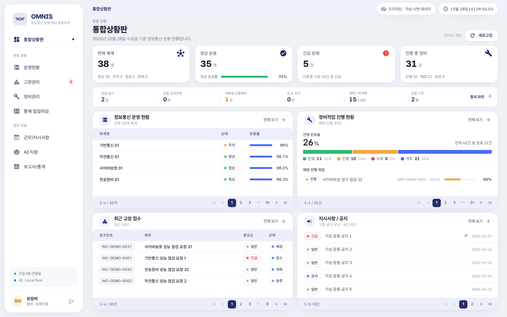

다중 PC 실시간 자료 공유, 실제 장비 자동 제어, 기존 계정 역할 정정·비밀번호 찾기·DB 복원 UI, 저장한 인수인계 다시 열기, 정비 캘린더 드래그 변경은 지원하지 않습니다.

## 저장·상태·날짜를 읽는 기준

| 확인 대상 | 사용자가 확인할 내용 |
| --- | --- |
| 저장과 완료 | 저장은 값이 기록되는 것, 완료·검증·종결은 각각 업무 상태가 바뀌는 것입니다. 저장 메시지 뒤 목록·상세·이력을 다시 확인합니다. |
| 검색 결과 없음 | 검색어·상태·중요도·날짜·담당자 조건을 지우고 다시 조회합니다. 일반 사용자는 본인 고장만 표시됩니다. |
| 상태 표시 | 조치완료는 조치 기록, 검증은 결과 검토, 종결은 실제 요청자 확인 후 종료입니다. 색상만 보지 말고 상태명을 읽습니다. |
| 날짜·시간 | 화면 시각은 한국 표준시로 읽습니다. 일일 PDF는 UTC 기준 집계와 차이가 있어 자정~08:59 기록을 별도로 대조합니다. |
| 08:30 / 16:00 | 업무 기준시간 표기입니다. 자동 입력 잠금·자동 마감 시각이 아닙니다. |
| 알림·확인 | 지시 읽음 확인, 경보 인지, 복구 확인은 의미가 다릅니다. 버튼 이름이 같아도 무엇을 확인하는지 읽습니다. |
| 자동 값 | 작업판 실적은 별도 입력입니다. 정비 완료로 자동 집계되거나 이월 작업이 자동 생성되지 않습니다. |

역할, 접수·작업번호, 화면 경로, 발생 시각, 메시지, 기대한 결과를 전달합니다. 비밀번호·API 키·불필요한 개인정보는 전달하지 않습니다.

# 2. 이 역할의 권한과 책임

이 표는 현재 코드의 역할·소유권·팀·상태 조건을 대조한 결과입니다. 모든 조합을 UI에서 실행한 표가 아닙니다. 실제 실행 범위는 각 절차와 검증 장을 확인합니다.

| 업무 | 현재 역할의 범위 |
| --- | --- |
| 업무 화면 조회 | 허용 |
| 관리 메뉴 | 금지 |
| 체계 등록·수정·상태 | 금지 |
| 체계 삭제 | 금지 |
| 고장 신규 접수 | 금지 |
| 고장 내용 수정 | 금지 |
| 고장 분류·팀 배정 | 금지 |
| 고장 진행·완료·검증 | 금지 |
| 고장 종결 | 금지 |
| 정비 작업 등록 | 금지 |
| 정비 수정·상태 | 금지 |
| 고장 첨부 변경 | 금지 |
| 정비 첨부 변경 | 금지 |
| 첨부 삭제 | 금지 |
| 상황경보 등록·처리 | 금지 |
| 작업판 입력 | 금지 |
| 정합성 결과 조회 | 허용 |
| 일일 마감 | 금지 |
| 인수인계 저장·확정 | 금지³ |
| 근무 편성 변경 | 금지 |
| 지시 등록·수정·삭제 | 금지 |
| 지시 읽음 확인 | 허용 |
| AI 고장 분류 실행 | 금지³ |
| AI 유사 고장 조회 | 금지 |
| AI 접수 값 반영 | 금지 |
| AI 요약·추천 조회 | 허용 |
| 통계·파일 내보내기 | 허용 |
| 계정 승인·반려 | 금지 |
| 설정·백업·초기화 | 금지 |

¹ 연결 고장·정비가 없는 체계만 삭제. ² 첨부는 소유권·팀·업무 상태 조건이 별도이며 삭제는 관리자/등록자 제한. ³ 버튼이 보여도 Main에서 거부될 수 있음. ⁴ 허용 범위 밖 정보 노출 가능성이 있어 활용·공유를 중단하고 문의.

업무 정보를 조회하고 지시를 읽음 확인할 수 있습니다. CSV/PDF·AI 요약·정비 추천도 허용되지만 자료 공유 범위는 별도로 확인합니다. 등록·수정·삭제·배정·마감·인계 저장은 수행하지 않습니다.

운용요원 또는 관리자에게 요청합니다. 조회한 번호, 화면 날짜, 현재 상태, 의문점과 공유 목적을 전달합니다. 변경이 필요한 건은 담당자에게 요청합니다.

# 3. 빠른 시작과 하루 업무

승인된 조회 계정과 조직에서 허용한 조회·공유 범위를 확인합니다.

아래 순서의 절차를 열고 가상 실습값으로 연습합니다. 실습은 교육용 환경에서만 수행합니다.

<link href="#C03" color="#087F8C">C03 메뉴·검색·필터·상세 화면 사용</link>

<link href="#C04" color="#087F8C">C04 통합상황판 읽기</link>

<link href="#T21" color="#087F8C">T21 지시사항 읽음 확인</link>

<link href="#C07" color="#087F8C">C07 일일·주간 보고서 조회와 파일 저장</link>

<link href="#C08" color="#087F8C">C08 조회전용의 AI 참고 정보 읽기</link>

## 권장 하루 업무 흐름

아래 순서는 권장 업무 흐름입니다. 필수 입력·역할 조건·상태 전이는 실제 시스템 제한입니다.

통합상황판의 갱신 시각·지표 범위를 확인합니다.

번호를 기준으로 상세와 이력을 조회하고 필요한 지시를 읽어 확인합니다.

조회 날짜와 주간 범위를 확인하고 자료 공유 권한을 점검합니다.

오해나 누락이 있으면 담당자에게 번호·시각·증상을 전달하고 로그아웃합니다.

조회한 번호, 화면 날짜, 현재 상태, 의문점과 공유 목적을 전달합니다. 변경이 필요한 건은 담당자에게 요청합니다.

담당자의 회신 이후 목록과 상세를 재조회합니다. 읽음 확인과 이행 완료를 구분합니다.

| 자주 하는 실수 | 확인 방법 |
| --- | --- |
| 조회전용이 모든 버튼을 정상 실행할 수 있다고 생각 | 번호·역할·현재 상태·저장 결과를 다시 읽고 해당 절차의 제한을 확인합니다. |
| AI 분석 버튼이 보인다는 이유로 분류 실행 권한이 있다고 판단 | 번호·역할·현재 상태·저장 결과를 다시 읽고 해당 절차의 제한을 확인합니다. |
| 읽음 확인을 이행 완료로 해석 | 번호·역할·현재 상태·저장 결과를 다시 읽고 해당 절차의 제한을 확인합니다. |
| 화면 지표·PDF 숫자가 다를 때 어느 한쪽을 검증 없이 보고 | 번호·역할·현재 상태·저장 결과를 다시 읽고 해당 절차의 제한을 확인합니다. |

# 4. 업무별 상세 사용 방법

직접 수행·조건부 수행·조회/요청을 각 절차에 표시했습니다. 읽기 → 준비 → 조작 → 결과 확인 → 인계 순서로 사용하세요. 화면 캡션과 검증 수준으로 현재 촬영과 기존 증거를 구분합니다.

| 구분 | 수록 내용 |
| --- | --- |
| 공통 C | 계정·검색·상황판·역할에 맞는 첨부와 AI·보고서 |
| 조회 R | 체계·고장·정비·작업판·근무/지시 읽기 |
| 업무 T | 이 역할에 허용된 업무 수행 또는 조회·요청 |
| 관리 A | 관리자 파일에만 계정 승인·설정·백업 등 포함 |

## C01 프로그램 시작·로그인·로그아웃

직접 수행(각 절차 사전 조건 적용)
이동: OMNIS 실행 → 접속 구분 → 로그인

업무를 시작하거나 공동 PC의 사용자를 교대할 때

승인된 조회전용 계정과 본인 비밀번호를 준비합니다. 화면의 demo 계정은 교육용 예시입니다.

1. 설치 담당자가 제공한 OMNIS 바로가기를 실행합니다. 이미 실행 중이면 기존 창을 확인합니다.

2. 접속 구분에서 사용자를 선택합니다. 관리자 구분으로 선택해도 관리자 권한이 생기지 않습니다.

3. 자동 입력된 데모 아이디가 있다면 자신의 승인된 아이디로 바꿉니다. 비밀번호를 입력하고 관리자 로그인 또는 사용자 로그인을 누릅니다.

4. 왼쪽 아래 역할이 조회전용인지 확인합니다. 다르면 업무를 중단하고 관리자에게 역할 확인을 요청합니다.

5. 이전 메뉴가 유지될 수 있으므로 왼쪽 통합상황판을 직접 눌러 업무 시작 위치를 맞춥니다.

6. 업무를 저장한 뒤 왼쪽 아래 로그아웃 아이콘을 누릅니다. 로그인 화면으로 돌아온 것을 확인하고 창을 닫습니다.

| 항목 | 필수 여부 | 의미·형식 | 예시 |
| --- | --- | --- | --- |
| 접속 구분 | 필수 | ADMIN은 관리자, 그 외는 사용자 | 사용자 |
| 아이디 | 필수 | 관리자가 승인한 계정 | 교육용 예: manual_trainee |
| 비밀번호 | 필수 | 등록한 비밀번호, 대소문자 주의 | 매뉴얼에 실제 비밀번호를 적지 않음 |

## C01 화면과 완료 확인

로그인 화면의 계정 입력 영역 | 기존 실행 증거 재사용 · 촬영: LOGIN · 가상 자료

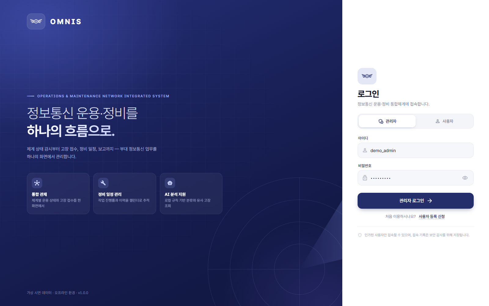

주 메뉴가 보이고 현재 사용자 이름과 역할이 맞으면 로그인 완료입니다. 새로 실행한 앱에는 다시 로그인해야 합니다.

자신의 역할별 빠른 시작을 읽고 필요한 업무로 이동합니다.

아이디·접속 구분·비밀번호를 확인합니다. 승인 대기·반려이면 관리자에게 신청 아이디와 메시지를 전달합니다. 비밀번호는 전달하지 않습니다.

자동 세션 만료나 비밀번호 찾기 화면은 확인되지 않았습니다. 공용 PC에서는 반드시 직접 로그아웃합니다. Windows 설치본의 새 PC 설치·업그레이드는 이번 실행 검증에 포함되지 않습니다.

검증 수준: 실제 UI 실행 확인
현재 VIEWER 로그인·로그아웃·메뉴 진입 확인.

## C02 사용자 등록 신청과 승인 기다리기

직접 수행(각 절차 사전 조건 적용)
이동: 로그인 화면 → 사용자 등록 신청

아직 계정이 없을 때

실제 등록에서는 소속 조직이 허용한 정보만 입력합니다. 아래 인적 정보는 형식 설명용 가상 예시입니다.

1. 사용자 등록 신청을 누릅니다.

2. 군번, 계급, 이름, 소속을 입력합니다. 연락처와 신청 사유는 필요할 때 입력합니다.

3. 아이디는 영문 소문자로 시작하는 4~20자로 정합니다. 소문자·숫자·밑줄만 사용할 수 있습니다.

4. 영문·숫자·특수문자를 포함한 8~64자 비밀번호를 입력하고 비밀번호 확인에 동일하게 입력합니다.

5. 등록 신청을 누릅니다. 입력 칸 아래 오류가 있으면 해당 칸을 수정합니다.

6. 사용자 등록 신청이 접수되었습니다 메시지를 확인하고 확인을 누릅니다. 관리자의 승인 전에는 로그인할 수 없습니다.

7. 관리자에게 신청 아이디와 원하는 업무 역할을 전달합니다. 비밀번호는 전달하지 않습니다.

| 항목 | 필수 여부 | 의미·형식 | 예시 |
| --- | --- | --- | --- |
| 군번 | 필수 | 숫자 2자리-숫자 5~8자리 | 가상 26-99000123 |
| 계급 | 필수 | 목록에서 선택 | 하사 |
| 이름 / 소속 | 필수 | 이름 2~20자, 소속 2~50자 | 가상교육자 / 가상 교육반 |
| 아이디 | 필수 | 첫 글자 영문 소문자 | manual_trainee |
| 연락처 | 선택 | 전화번호 형식에 맞게 입력 | 교육에서는 공란 |
| 신청 사유 | 선택 | 300자 이하 | 교육용 고장 접수 연습 |

## C02 화면과 완료 확인

사용자 등록 신청서 | 기존 실행 증거 재사용 · 촬영: LOGIN · 가상 자료

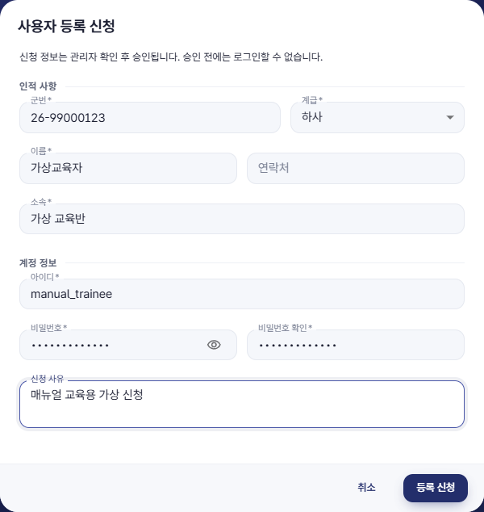

접수 완료 안내가 나타납니다. 신청 완료와 계정 승인은 별개입니다.

관리자가 해당 담당자의 후속 업무 절차로 승인한 뒤 C01로 로그인합니다.

중복 아이디·군번이면 기존 신청 여부를 관리자에게 확인합니다. 반려된 신청은 로그인 시 표시되는 사유를 확인합니다. 재신청 가능 여부는 관리자에게 문의하고 중복 신청을 반복하지 않습니다.

신청자는 직접 역할을 정하지 않습니다. 승인된 기존 계정의 역할 변경·비밀번호 재설정 UI는 별도 제공되지 않습니다.

검증 수준: 실제 UI 실행 확인(기존 로그인 전 증거)
이전 UI01의 로그인 전 신청 화면. 아직 역할이 부여되지 않은 신청이며 특정 승인 역할의 실행 검증이 아님.

## C03 메뉴·검색·필터·상세 화면 사용

조회·확인 / 담당자에게 요청
이동: 왼쪽 주 메뉴 → 목록 → 상세 아이콘

원하는 자료를 찾거나 저장 내용을 재확인할 때

조회 범위는 역할과 업무에 따라 다릅니다. 일반 사용자의 고장관리 목록은 본인 접수 건입니다.

1. 왼쪽 메뉴에서 운영현황, 고장관리, 정비관리 등 업무 화면을 선택합니다.

2. 검색 칸에 제목 또는 번호의 일부를 입력합니다. 메뉴에 따라 체계명/코드, 제목/접수번호, 작업명/작업번호를 검색합니다.

3. 고장관리에서 중요도, 시작일, 종료일, 담당자 필터를 필요한 경우 지정합니다.

4. 상태 버튼을 눌러 접수·진행·완료 등 현재 상태를 좁힙니다. 상태와 검색 조건은 함께 적용됩니다.

5. 검색 결과가 없으면 검색어를 지우고 상태를 전체로 바꿉니다. 필터 초기화가 있으면 누른 뒤 날짜·담당자 조건도 확인합니다.

6. 행 오른쪽 상세 아이콘을 눌러 내용을 확인합니다. 일부 표는 행 클릭이 아니라 상세 아이콘으로 열립니다.

7. 행의 오른쪽 작업 버튼이 보이지 않으면 표 내부 가로 스크롤을 이동합니다. 표 아래 페이지·페이지당 행 수를 확인합니다.

| 항목 | 필수 여부 | 의미·형식 | 예시 |
| --- | --- | --- | --- |
| 검색 | 선택 | 일부 문자열로 조회 | 교육용 회선 장애 |
| 시작일 / 종료일 | 선택 | 고장 접수일의 범위 | 교육 진행 날짜 |
| 담당자 | 선택 | 신고자가 아닌 배정된 사람 | 담당 정비요원 |

## C03 화면과 완료 확인

검색 결과가 없을 때 | 기존 실행 증거 재사용 · 촬영: 관리자 · 가상 자료

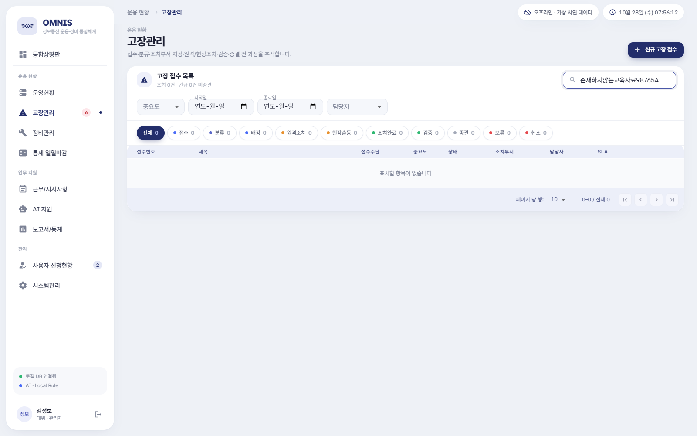

확대 보기: 화면의 목록·입력 영역 | 기존 실행 증거 재사용 · 촬영: 관리자 · 가상 자료

원하는 번호와 제목을 확인한 뒤 상세 창이 열립니다. 필터된 건수는 전체 DB 건수와 다를 수 있습니다.

상세에서 기록을 확인한 뒤 닫기를 누릅니다. 변경은 해당 업무의 저장/처리 절차를 따릅니다.

목록이 비었다고 자료가 삭제됐다고 단정하지 않습니다. 검색·필터·권한·페이지를 순서대로 확인합니다. 저장 직후에는 메뉴를 다시 열어 재조회할 수 있습니다.

여러 창/역할에서 동시에 수정한 값의 실시간 동기화를 보장하지 않습니다. 필터 초기화는 검색어와 상태 선택까지 모두 지우는 버튼이 아닙니다.

검증 수준: 코드·설정 확인
이 역할의 상세 조작 전체는 UI 미검증. 타 역할 화면은 공통 화면 구조 설명용. UI16 및 역할별 메뉴 실행

## C04 통합상황판 읽기

조회·확인 / 담당자에게 요청
이동: 통합상황판

업무 시작 때 현황과 우선 확인 대상을 파악할 때

업무 데이터는 이 PC의 로컬 DB에 저장됩니다. 상단 오프라인 · 가상 시연 데이터 문구를 확인합니다.

1. 새로고침을 눌러 표시된 갱신 시각을 확인합니다.

2. 전체 체계, 정상 운용, 긴급 장애, 진행 중 정비 카드를 읽습니다. 정상 운용률은 체계 상태를 요약한 값입니다.

3. 카드를 누르면 해당 집계의 목록이 열립니다. 조회 권한이 허용된 업무인지 먼저 확인합니다.

4. 최근 고장 접수에서 접수번호·중요도·상태를 보고 담당 업무를 고장관리에서 확인합니다.

5. 통제 화면 또는 금일 접수/완료/경보 요약 영역을 눌러 통제·일일마감으로 이동합니다.

6. 지시사항 / 공지 내용을 읽고 실제 확인 처리는 근무/지시사항에서 수행합니다.

| 항목 | 필수 여부 | 의미·형식 | 예시 |
| --- | --- | --- | --- |
| 갱신 시각 | 조회 | 마지막으로 이 화면을 불러온 시각 | 현재 표시값 |
| 긴급 장애 | 조회 | 미종결 긴급 고장 요약 | 건수와 개별 상태를 함께 확인 |
| 운용률 | 조회 | 입력된 수치와 상태 기반 요약 | 자동 센서 측정값 아님 |

## C04 화면과 완료 확인

VIEWER의 현재 역할 표시 | 현재 재확인 화면 · 촬영: 조회전용 · 가상 자료

확대 보기: 화면의 목록·입력 영역 | 현재 재확인 화면 · 촬영: 조회전용 · 가상 자료

필요한 고장·정비·지시사항의 번호를 확보하고 해당 업무 화면으로 이동할 수 있습니다.

운용요원은 긴급 건 배정, 정비요원은 담당 작업, 일반 사용자는 본인 접수 확인으로 이어갑니다.

카드와 목록의 숫자가 다르면 대상 범위와 새로고침 시각을 확인합니다. 금일 고장 값은 자동 증가가 보장되지 않아 접수 목록과 대조합니다.

현재 일반 사용자에게 다른 접수 내용이 요약 화면 등에서 노출되는 결함이 재현됐습니다. 본인 업무가 아닌 내용은 이용·공유하지 말고 관리자에게 알립니다. 조직 전체 데이터 접근 허가로 해석하지 않습니다.

검증 수준: 실제 UI 실행 확인 + 코드·설정 확인
현재 VIEWER의 메뉴·목록 확인. 상세의 모든 조합은 재실행하지 않음.

## C05 첨부자료 조회·열기

조회·확인 / 담당자에게 요청
이동: 고장관리 또는 정비관리 → 상세 → 첨부자료

고장·정비 기록에 이미 등록된 사진·문서·점검표의 내용을 확인할 때

조회전용은 고장·정비 첨부를 조회할 수 있지만 추가·삭제할 수 없습니다.

1. 정확한 접수번호 또는 작업번호의 상세를 엽니다.

2. 첨부자료 목록에서 파일명·자료 구분·등록자·크기·설명을 확인합니다.

3. 열기 아이콘을 누르면 Windows 기본 연결 앱으로 파일이 열립니다. 기본 연결 앱 실행은 이번 실제 검증 범위 밖입니다.

4. 잘못된 파일이나 누락은 업무 번호와 파일명을 적어 등록자 또는 관리자에게 요청합니다.

| 항목 | 필수 여부 | 의미·형식 | 예시 |
| --- | --- | --- | --- |
| 업무 번호 | 조회 | 고장 또는 정비의 번호 | 확인 대상 번호 |
| 파일명 | 조회 | 현재 첨부된 자료 | 교육용점검.txt |

## C05 화면과 완료 확인

고장에 첨부된 가상 로그 | 기존 실행 증거 재사용 · 촬영: 일반 사용자 · 가상 자료

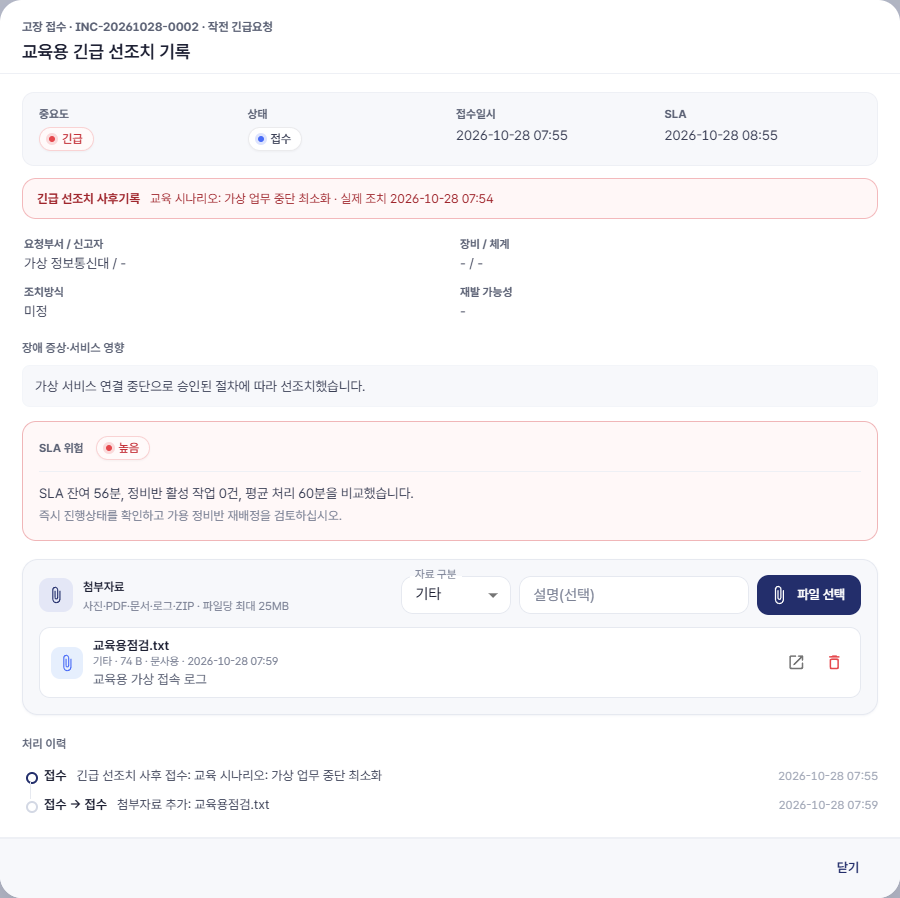

업무에 연결된 자료의 이름과 의미를 확인합니다. 추가·삭제는 수행하지 않습니다.

공유 전 조직의 허용 범위를 확인합니다.

권한·저장 위치·기본 연결 앱 문제는 업무 번호와 파일명을 관리자에게 전달합니다.

추가·삭제 버튼이 보이더라도 변경하지 않습니다. 삭제·복구는 관리자에게 요청합니다.

검증 수준: 코드·설정 확인
이 역할의 상세 조작 전체는 UI 미검증. 타 역할 화면은 공통 화면 구조 설명용. UI20: 파일 선택창 대체 / P08 / OS 기본 앱 열기 미검증

## C07 일일·주간 보고서 조회와 파일 저장

직접 수행(각 절차 사전 조건 적용)
이동: 보고서/통계 → 일일 또는 주간

일별 접수·정비 예정 실적을 확인하거나 보고 자료를 준비할 때

내보내기는 허용된 정보와 수신 범위를 확인한 뒤 수행합니다. 일반 사용자의 전체 CSV 노출 결함이 있어 임의 내보내기·공유를 피하고 관리자 확인을 받습니다.

1. 일일 탭에서 조회일을 선택한 뒤 조회를 누릅니다. 날짜만 바꿔서는 기존 표시가 자동 갱신되지 않을 수 있습니다.

2. 상단의 표시 날짜와 고장 접수·정비 예정 건수를 확인합니다. 정비 예정 건수는 완료 실적 건수가 아닙니다.

3. 주간 탭에서 시작일을 선택하고 조회를 누릅니다. 시작일부터 7일간의 추이와 합계를 읽습니다.

4. 고장 CSV 또는 정비 CSV를 누르고 저장 위치와 파일명을 선택합니다.

5. 저장됨 메시지의 경로를 확인합니다. CSV는 현재 날짜·검색 필터로 제한된 내보내기가 아닙니다.

6. 일일 PDF가 필요하면 일일 탭의 조회일을 확인한 뒤 일일 PDF를 누릅니다.

7. 생성 파일을 열어 날짜, 건수, 접수번호와 한글을 확인하고 화면과 대조한 뒤 전달합니다.

| 항목 | 필수 여부 | 의미·형식 | 예시 |
| --- | --- | --- | --- |
| 조회일 | 필수 | 일일 집계의 기준 날짜 | 교육 진행 날짜 |
| 시작일 | 필수 | 해당일부터 7일 | 교육 주 시작 날짜 |
| 파일명/위치 | 저장 시 선택 | 권한이 있는 로컬 폴더 | 교육결과_일일.pdf |

## C07 화면과 완료 확인

조회전용의 주간 통계 | 기존 실행 증거 재사용 · 촬영: 조회전용 · 가상 자료

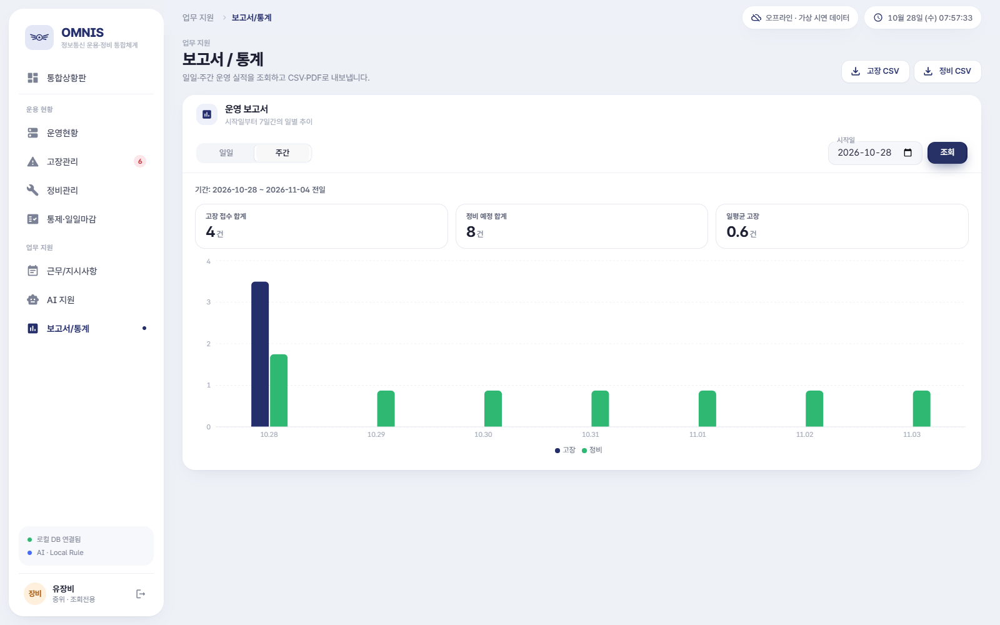

확대 보기: 화면의 목록·입력 영역 | 기존 실행 증거 재사용 · 촬영: 조회전용 · 가상 자료

저장 완료 경로와 실제 파일이 확인되면 내보내기 완료입니다. 저장창 취소는 저장 성공이 아닙니다.

다른 사용자에게 전달하기 전에 데이터 범위와 날짜를 검토합니다.

화면과 PDF 건수가 다르면 재접수를 만들지 말고 해당 날짜와 접수번호를 관리자에게 전달합니다. 저장 실패는 경로 접근 권한·열린 파일·디스크 공간을 확인합니다.

한국시간 자정~08:59 접수 건의 PDF 집계가 화면과 달라질 수 있는 결함이 재현됐습니다. PDF를 유일한 업무 증거로 사용하지 않습니다. 주간 PDF와 월간 보고서 전용 버튼은 없습니다.

검증 수준: 코드·설정 확인
이 역할의 상세 조작 전체는 UI 미검증. 타 역할 화면은 공통 화면 구조 설명용. UI17·UI21 화면; 기존 smoke E2E / P02·P03 내부 검증

## C08 조회전용의 AI 참고 정보 읽기

조회·확인 / 담당자에게 요청
이동: AI 지원 → 일일 요약 생성 / 정비 우선순위 조회

변경 없이 업무 요약과 정비 추천 순서를 읽을 때

조회전용은 일일 요약과 정비 추천을 읽을 수 있습니다. 고장 분류와 유사 고장 검색은 모두 금지됩니다.

1. AI 지원을 엽니다.

2. 일일 요약 생성을 눌러 현재 미처리 업무 요약을 읽습니다.

3. 정비 우선순위 조회를 눌러 예정·진행·보류 작업의 참고 순서를 읽습니다.

4. 개별 작업번호를 정비관리에서 확인합니다.

5. 고장 분류가 필요하면 접수번호와 증상을 운용요원에게 전달합니다.

| 항목 | 필수 여부 | 의미·형식 | 예시 |
| --- | --- | --- | --- |
| 일일 요약 | 조회 | 미처리 현황의 참고 요약 | 모든 당일 실적을 의미하지 않음 |
| 정비 우선순위 | 조회 | 우선순위·예정일 기반 | 작업 명령 아님 |

## C08 화면과 완료 확인

VIEWER의 현재 AI 결과와 허용 범위 | 현재 재확인 화면 · 촬영: 조회전용 · 가상 자료

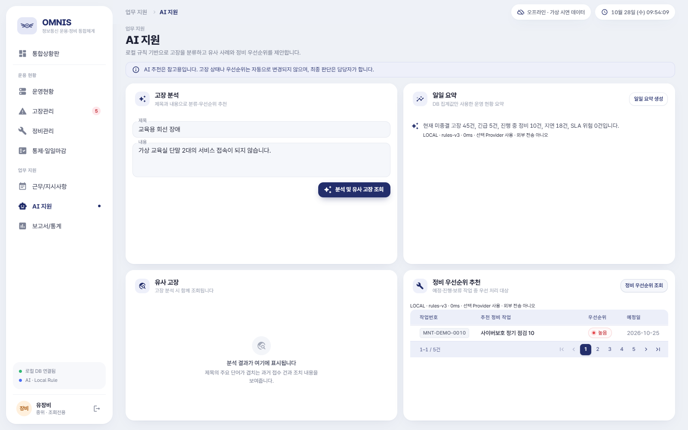

확대 보기: 화면의 목록·입력 영역 | 현재 재확인 화면 · 촬영: 조회전용 · 가상 자료

요약 문장과 추천 목록이 표시됩니다. 실제 작업의 상태는 바뀌지 않습니다.

필요한 사실은 원래 업무 화면에서 대조합니다.

분석 및 유사 고장 조회는 권한 오류가 발생합니다. 분류가 필요하면 운용요원에게 번호·증상을 전달합니다.

추천은 작업 명령이 아닙니다. 외부 전송·fallback 표시를 확인합니다. 실제 외부 모델 품질은 미검증입니다.

검증 수준: 실제 UI 실행 확인
현재 VIEWER의 AI 실행/거부·내부 권한 검사. Local Rule만 실행.

## R01 체계 상태와 상태 이력 조회

조회·확인 / 담당자에게 요청
이동: 운영현황 → 검색 → 상세

대상 체계가 정상·주의·장애 중 어느 상태인지 확인할 때

조회할 체계명 또는 코드를 준비합니다. 운용률은 자동 센서 측정값이 아닌 입력값입니다.

1. 운영현황을 선택하고 체계명 또는 코드 일부로 검색합니다.

2. 행의 상태와 운용률을 읽고 상세 아이콘을 누릅니다.

3. 상태 이력의 시각과 변화를 읽습니다. 현재 상태와 과거 이력을 구분합니다.

4. 차이가 있으면 체계명·코드·표시 시각·확인한 사실을 운용요원에게 전달합니다.

## R01 화면과 완료 확인

VIEWER의 운영현황 조회 화면 | 현재 재확인 화면 · 촬영: 조회전용 · 가상 자료

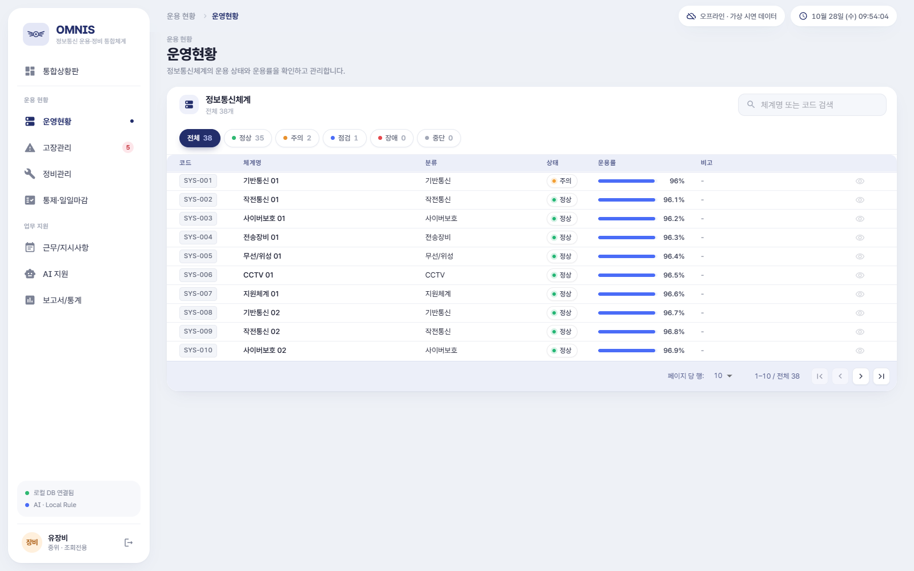

확대 보기: 화면의 목록·입력 영역 | 현재 재확인 화면 · 촬영: 조회전용 · 가상 자료

체계 코드, 현재 상태, 마지막 확인 시각과 근거를 설명할 수 있습니다.

변경이 필요한 경우 변경 권한이 있는 담당자에게 사실과 근거를 전달합니다.

검색 결과가 없으면 검색어와 상태 필터를 지우고 다시 조회합니다.

최근 30일 운용률 그래프의 입력 자료는 최근 30개 기록 제한이며, 아래 상태 이력은 그중 최근 6개를 표시합니다. 수정·상태 저장은 조회와 별개의 권한입니다.

검증 수준: 실제 UI 실행 확인 + 코드·설정 확인
현재 VIEWER의 메뉴·목록 확인. 상세의 모든 조합은 재실행하지 않음.

## R02 고장 상태·담당자·처리 이력 조회

조회·확인 / 담당자에게 요청
이동: 고장관리 → 검색 → 상세

접수 이후 진행을 확인하거나 다음 담당자에게 문의할 때

정확한 접수번호를 준비합니다. 일반 사용자는 본인 접수만 조회합니다.

1. 고장관리의 검색 칸에 접수번호 또는 제목 일부를 입력합니다.

2. 날짜·중요도·담당자·상태 필터를 확인합니다.

3. 상세를 열어 증상, 영향, 배정된 정비반·담당자, SLA와 현재 상태를 읽습니다.

4. 처리 이력을 시간 순으로 읽고 가장 최근 상태와 다음 조치를 확인합니다.

5. 정정이 필요하면 번호, 현재 값, 바꿀 값, 정정 이유를 담당자에게 전달합니다.

## R02 화면과 완료 확인

VIEWER의 고장관리 조회 화면 | 현재 재확인 화면 · 촬영: 조회전용 · 가상 자료

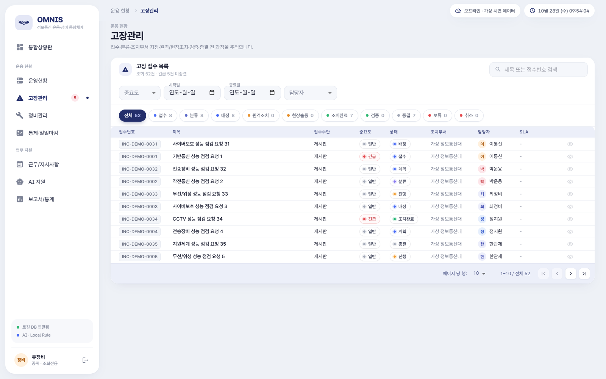

확대 보기: 화면의 목록·입력 영역 | 현재 재확인 화면 · 촬영: 조회전용 · 가상 자료

접수번호와 현재 상태, 마지막 조치, 다음 담당자를 확인합니다.

요청자는 추가 정보를 제공하고, 조치 담당자는 맡은 범위에서 후속 절차를 수행합니다.

자료가 없으면 필터와 로그인 계정을 먼저 확인합니다. 타인의 계정으로 우회하지 않습니다.

조치완료·검증·종결은 서로 다른 단계입니다. 조회 가능하다고 수정할 수 있는 것은 아닙니다.

검증 수준: 실제 UI 실행 확인 + 코드·설정 확인
현재 VIEWER의 메뉴·목록 확인. 상세의 모든 조합은 재실행하지 않음.

## R03 정비 작업·예정일·완료 결과 조회

조회·확인 / 담당자에게 요청
이동: 정비관리 → 목록 → 상세

정비 일정과 실제 기록된 조치 결과를 확인할 때

작업번호는 고장 접수번호와 별개입니다. 연계된 고장이 있다면 두 번호를 함께 준비합니다.

1. 정비관리에서 작업명 또는 작업번호로 검색합니다.

2. 상태와 예정일을 확인하고 상세를 누릅니다.

3. 담당자, 원인 분석, 상세 조치내용, 작업 결과와 이력을 읽습니다.

4. 연계 고장이 있으면 그 접수번호의 상태도 별도로 확인합니다.

5. 변경이 필요하면 작업 담당 정비요원 또는 관리자에게 번호와 정정 이유를 전달합니다.

## R03 화면과 완료 확인

VIEWER의 정비관리 조회 화면 | 현재 재확인 화면 · 촬영: 조회전용 · 가상 자료

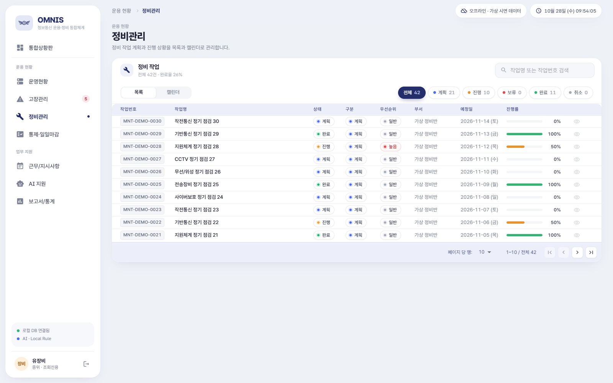

확대 보기: 화면의 목록·입력 영역 | 현재 재확인 화면 · 촬영: 조회전용 · 가상 자료

작업 상태, 예정일, 기록된 결과와 연계 고장을 구분합니다.

단순 완료 표시만으로 실제 복구를 확정하지 말고 필요한 확인 근거를 담당자에게 요청합니다.

첨부 접근 오류는 정비 목록 조회와 첨부 권한 조건이 다른 경우에도 발생합니다.

진행률 50%·100%는 상태 변경 규칙의 표시값입니다. 실제 물리적 진행률 측정값으로 해석하지 않습니다.

검증 수준: 실제 UI 실행 확인 + 코드·설정 확인
현재 VIEWER의 메뉴·목록 확인. 상세의 모든 조합은 재실행하지 않음.

## R04 상황경보·작업판·마감 상태 읽기

조회·확인 / 담당자에게 요청
이동: 통제·일일마감 → 상황경보 / 08:30 · 16:00 작업판 / 정합성 · 마감

업무 상황과 해당 날짜 실적을 확인할 때

확인할 기준일과 정비반을 먼저 정합니다.

1. 상단 기준일을 맞춥니다.

2. 상황경보에서 번호·유형·상태를 읽습니다. 경보 목록은 기준일만으로 모두 필터링되는 것이 아닙니다.

3. 08:30 · 16:00 작업판에서 팀별 계획·비계획·완료·이월과 미완료 사유를 읽습니다.

4. 정합성 · 마감에서 확인이 필요한 문제와 마감 완료 여부를 확인합니다.

5. 차이가 있으면 기준일·팀·원본 번호·문제 내용을 관리자에게 전달합니다.

## R04 화면과 완료 확인

VIEWER의 통제·일일마감 조회 화면 | 현재 재확인 화면 · 촬영: 조회전용 · 가상 자료

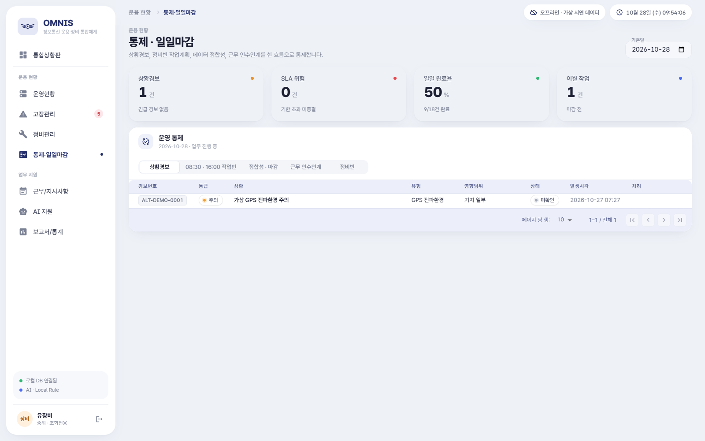

확대 보기: 화면의 목록·입력 영역 | 현재 재확인 화면 · 촬영: 조회전용 · 가상 자료

선택 날짜의 입력 실적, 이월과 마감 여부를 구분합니다.

미해결 건은 해당 담당자에게 보완을 요청합니다. 마감 결정은 관리자 업무입니다.

조회 기준일과 원본 기록 날짜를 맞추고 메뉴에 다시 들어가 재조회합니다.

시간 표시는 자동 마감 예약이 아닙니다. 마감 뒤 수치 변경을 시도하지 않습니다.

검증 수준: 실제 UI 실행 확인 + 코드·설정 확인
현재 VIEWER의 메뉴·목록 확인. 상세의 모든 조합은 재실행하지 않음.

## R05 근무 편성과 지시사항 조회

조회·확인 / 담당자에게 요청
이동: 근무/지시사항 → 근무현황 / 지시사항

이번 근무의 담당자와 전달된 지시를 확인할 때

근무 날짜와 교대 구분을 확인합니다.

1. 근무/지시사항에서 근무현황 탭을 엽니다.

2. 일자·주간/야간/당직·담당자·직책을 확인합니다.

3. 지시사항 탭에서 제목·내용·중요도·담당자·기한·이행 상태를 읽습니다.

4. 본인이 내용을 읽었다면 지시사항 읽음 확인 절차를 수행합니다.

5. 담당이나 시간이 다르면 운용요원에게 정정 요청 내용을 전달합니다.

## R05 화면과 완료 확인

VIEWER의 근무/지시사항 조회 화면 | 현재 재확인 화면 · 촬영: 조회전용 · 가상 자료

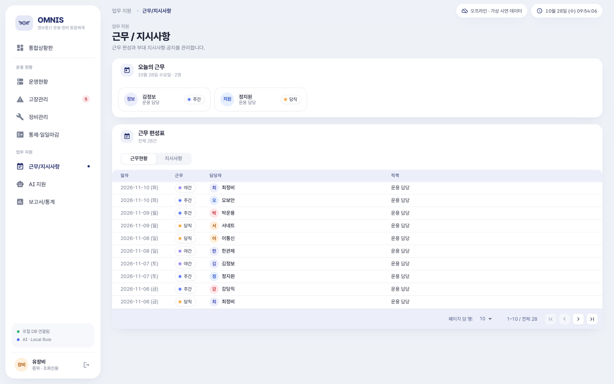

확대 보기: 화면의 목록·입력 영역 | 현재 재확인 화면 · 촬영: 조회전용 · 가상 자료

본인 근무와 관련 지시의 기한을 확인합니다.

변경 권한이 없는 역할은 직접 편성을 수정하지 않고 담당자에게 요청합니다.

목록이 비면 날짜와 탭을 다시 확인합니다.

지시사항의 확인은 읽음 표시입니다. 실제 이행 완료를 대신하지 않습니다. 별도 자유 형식 근무일지 편집 화면은 없습니다.

검증 수준: 실제 UI 실행 확인 + 코드·설정 확인
현재 VIEWER의 메뉴·목록 확인. 상세의 모든 조합은 재실행하지 않음.

## T13 정비 캘린더 일정 조회

조회·확인 / 담당자에게 요청
이동: 정비관리 → 캘린더

날짜별 정비 계획을 확인할 때

이 역할은 정비 예정일을 직접 바꿀 수 없습니다. 작업번호와 확인할 월을 준비합니다.

1. 정비관리에서 캘린더 탭을 누릅니다.

2. 이전·다음으로 원하는 월을 찾습니다.

3. 달력에 표시된 작업명과 날짜를 읽습니다. 작업명을 눌러 상세를 여는 기능은 없습니다.

4. 목록 탭으로 돌아가 같은 작업명을 검색하고 상세에서 작업번호·예정일·상태를 확인합니다.

5. 변경이 필요하면 작업번호·현재 예정일·희망일·이유를 정비요원 또는 관리자에게 전달합니다.

6. 변경 완료 회신을 받은 뒤 캘린더를 다시 열어 예정일을 확인합니다.

| 항목 | 필수 여부 | 의미·형식 | 예시 |
| --- | --- | --- | --- |
| 확인할 월 | 조회 | 상단 월 표시 | 교육 진행 월 |

## T13 화면과 완료 확인

정비 캘린더 | 기존 실행 증거 재사용 · 촬영: 정비요원 · 가상 자료

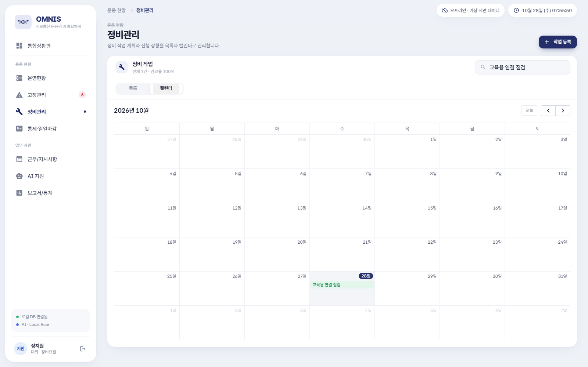

확대 보기: 화면의 목록·입력 영역 | 기존 실행 증거 재사용 · 촬영: 정비요원 · 가상 자료

작업의 예정일을 확인합니다. 변경은 담당자가 수행한 뒤 재조회합니다.

변경된 예정일을 본인 업무 계획과 대조합니다.

목록의 검색 조건과 캘린더 표시 월을 확인합니다.

날짜를 드래그하거나 수정 아이콘으로 직접 변경하지 않습니다. 이 역할의 정비 일정 변경 권한은 없습니다. 캘린더 작업 클릭 상세 열기도 구현되지 않았습니다.

검증 수준: 코드·설정 확인 + 기존 UI 증거
현재 캘린더는 작업 클릭 상세 열기를 구현하지 않음. 목록 상세 조회로 안내 수정. 이전 UI09 촬영은 MAINTAINER 역할.

## T16 마감 전 정합성 문제 확인

조회·확인 / 담당자에게 요청
이동: 통제·일일마감 → 정합성 · 마감

고장·정비·작업판 기록의 불일치를 점검할 때

기준일을 확인합니다. 조회는 가능하지만 원본 기록 수정은 각 업무의 권한을 따라야 합니다.

1. 기준일을 선택하고 정합성 · 마감 탭을 누릅니다.

2. 대상 번호·문제 설명·상태를 읽고 기록합니다.

3. 원인·조치 누락은 담당 정비요원에게, 작업판 건수는 팀 담당자에게, 마감 판단은 관리자에게 전달합니다.

4. 담당자가 보완한 뒤 메뉴를 다시 열어 결과를 재조회합니다.

| 항목 | 필수 여부 | 의미·형식 | 예시 |
| --- | --- | --- | --- |
| 기준일 | 필수 | 검사할 날짜 | 마감 대상 날짜 |
| 검사유형 / 점검 결과 | 조회 | 코드와 설명을 함께 읽음 | 조치결과 누락 |

## T16 화면과 완료 확인

마감 전 정합성 점검 | 기존 실행 증거 재사용 · 촬영: 관리자 · 가상 자료

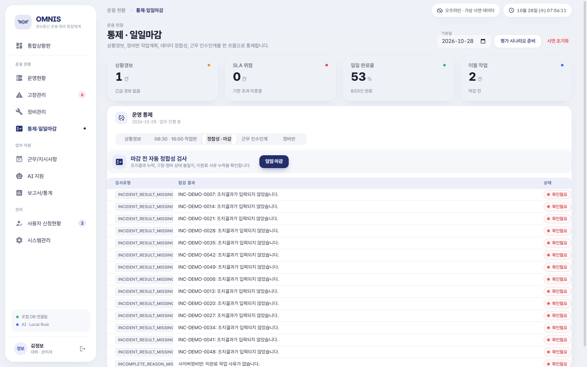

확대 보기: 화면의 목록·입력 영역 | 기존 실행 증거 재사용 · 촬영: 관리자 · 가상 자료

자신이 수정하는 대신 보완할 대상·담당자·기한이 명확해집니다.

관리자는 T17에서 정상 마감 또는 예외 마감 여부를 결정합니다.

이상이 없다는 문구는 구현된 검사 범위에서만 의미가 있습니다. 누락된 모든 업무나 실제 장비 상태까지 보증하지 않습니다.

개별 정합성 항목을 화면에서 검토·승인하는 버튼은 없습니다. 내부 기능이 있다고 사용자에게 별도 승인 버튼을 찾으라고 안내하지 않습니다.

검증 수준: 코드·설정 확인
이 역할의 상세 조작 전체는 UI 미검증. 타 역할 화면은 공통 화면 구조 설명용. UI15 화면 / 코드

## T21 지시사항 읽음 확인

직접 수행(각 절차 사전 조건 적용)
이동: 근무/지시사항 → 지시사항 → 확인

본인에게 필요한 지시 내용을 읽었음을 표시할 때

제목·본문·기한·담당자·첨부되지 않은 별도 지시 여부를 확인합니다.

1. 지시사항 탭을 엽니다.

2. 자신에게 해당하는 지시의 제목과 내용을 읽습니다.

3. 등급·기한·담당자·현재 이행 상태를 확인합니다.

4. 이해한 뒤 해당 카드의 확인을 누릅니다.

5. 본인의 확인 버튼이 사라지고 확인 인원이 반영되는지 확인합니다.

6. 수행 결과는 담당 관리 역할에 전달하여 이행 상태를 갱신하도록 합니다.

| 항목 | 필수 여부 | 의미·형식 | 예시 |
| --- | --- | --- | --- |
| 확인 | 사용자 판단 | 내용을 읽었다는 기록 | 실제 읽은 뒤 실행 |

## T21 화면과 완료 확인

조회전용 지시 읽음 확인 후 | 현재 재확인 화면 · 촬영: 조회전용 · 가상 자료

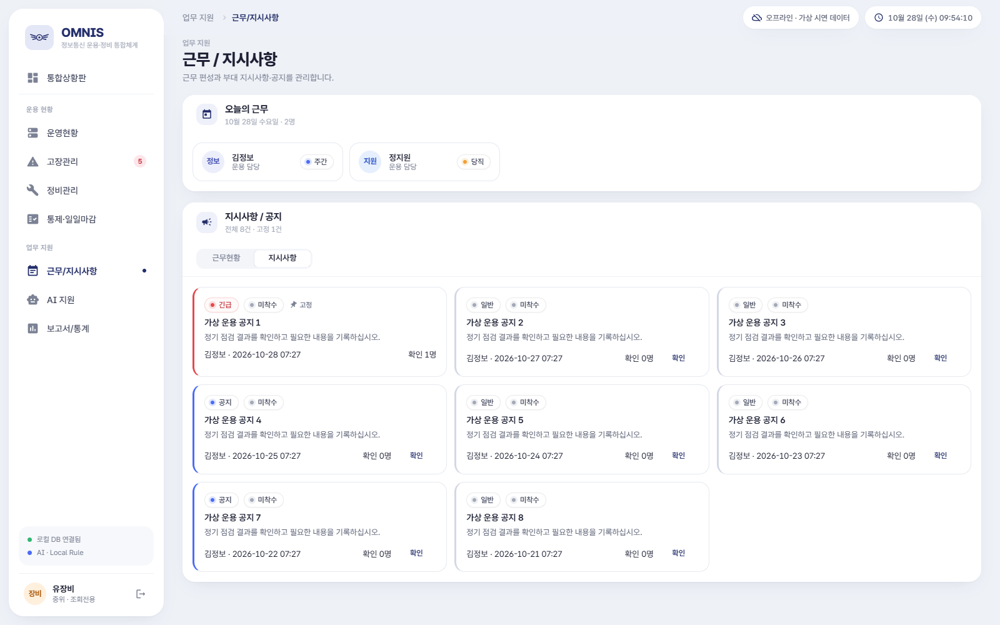

확대 보기: 화면의 목록·입력 영역 | 현재 재확인 화면 · 촬영: 조회전용 · 가상 자료

같은 사용자의 중복 확인이 방지되고 확인 기록이 남습니다.

필요한 실제 업무를 수행하고 결과를 보고합니다.

확인 버튼이 없으면 이미 확인했을 수 있습니다. 업무 완료 여부는 이행 상태로 별도 확인합니다.

조회전용도 지시 확인은 가능합니다. 따라서 “아무 기록도 변경하지 않는 역할”이라고 단정하지 않습니다.

검증 수준: 실제 UI 실행 확인
현재 조회전용의 확인 클릭과 재조회.

# 5. 역할별 실습과 인수인계

교육용 회선 장애: 가상 교육실 단말 2대의 접속 불가. 실제 장비 제어를 수행하는 실습이 아닙니다. 생성된 접수번호와 작업번호를 기록하며 역할을 바꾸면 본인 계정으로 다시 로그인합니다.

지정된 교육 사례의 고장 상태와 정비 예정일을 읽습니다. 지시사항을 확인하고 주간 통계의 시작일·7일 범위·합계를 확인합니다.

AI 지원의 분석 및 유사 고장 조회는 권한 오류가 발생합니다. 분류와 유사 검색 모두 금지되므로 반복하지 않습니다. 일일 요약 생성·정비 우선순위 조회는 사용할 수 있습니다.

| 연습 자료 | 값 또는 확인 기준 |
| --- | --- |
| 제목 / 증상 | 교육용 회선 장애 / 가상 교육실 단말 2대 접속 불가 |
| 대상 체계 | 교육 환경에 존재하는 가상 통신 체계를 선택. 새 체계는 허용 역할만 등록 |
| 시각 | 교육 진행 당일 실제 입력 시각, 한국 표준시. 문서 날짜를 무조건 복사하지 않음 |
| 처리 근거 | 교육용 점검: 원인 가설과 확인 사실을 구분. 실제 복구 확인을 임의로 체크하지 않음 |
| 결과 | 역할별 상세 절차의 상태·저장 결과와 대조. 존재하지 않는 승인·재개 버튼 사용 금지 |

| 완료 점검 | 확인할 내용 |
| --- | --- |
| 1 | 조회일과 데이터 범위를 확인함 |
| 2 | 변경 업무를 수행하지 않음 |
| 3 | 읽음과 작업 완료를 구분함 |
| 4 | 내보내기 전 공유 권한과 날짜 차이를 확인함 |

## 한 건의 업무가 이어지는 지점

| 단계·주체 | 이 역할이 이해하고 확인할 결과 |
| --- | --- |
| 접수 / 요청자 | 증상·영향·발생 시각이 담긴 접수번호 생성 |
| 분류·배정 / 운용 담당 | 분류 상태와 정비반·개인 담당자 확정. AI 반영만으로 배정되는 것은 아님 |
| 조치 / 배정 담당 | 조치 방법·원인·결과·잔여 작업 기록, 조치완료 상태 |
| 검증 / 권한 있는 담당 | 근거 검토 후 검증 상태. 실제 요청자 확인을 대신하지 않음 |
| 종결 / 요청자 또는 권한 담당 | 요청자의 실제 복구 확인 사실을 근거로 종결. 재개 UI 없음 |

조회한 번호, 화면 날짜, 현재 상태, 의문점과 공유 목적을 전달합니다. 변경이 필요한 건은 담당자에게 요청합니다.

담당자의 회신 이후 목록과 상세를 재조회합니다. 읽음 확인과 이행 완료를 구분합니다.

대표 경로입니다. 모든 화살표를 이 역할이 누르는 것이 아닙니다. 각 단계의 직접 수행 여부는 권한표와 상세 절차를 따릅니다.

## 계획·실적·마감 인계 사례

| 기록 | 예시 | 책임 |
| --- | --- | --- |
| 계획 / 비계획 | 2 / 1 | 가용 소속팀 정비요원 또는 관리자 |
| 완료 / 이월 | 2 / 1 → 완료율 67% | 원본 정비와 실제 처리 사실 대조 |
| 미완료 사유 | 가상 점검 장비 확보 대기 1건 | 팀 담당자 |
| 마감 판단 | 기준일·문제·예외 확인 | 관리자 |
| 인계 | 번호·상태·미완료·다음 담당·확인 시각 | 허용 역할의 기록 / 조회전용은 요청 |

기준일·팀·마감 상태를 읽고 차이를 관리자에게 전달합니다. 작업판 입력·마감·인계 저장을 수행하지 않습니다.

정비 완료가 작업판 실적을 자동 계산하지 않습니다. 이월 숫자가 다음날 정비를 만들지 않으며 16:00에 자동 마감되지 않습니다. 확정 인계는 앱에서 다시 열 수 없으므로 담당자가 승인된 별도 기록에 보관합니다.

## 한 장 업무 요약

운영 현황·고장·정비·통계·지시사항을 조회하고 상황을 이해합니다. 지시 확인과 일부 조회성 AI 기능은 사용할 수 있지만 등록·수정·배정·마감 역할은 아닙니다.

| 순서 | 빠른 이동 |
| --- | --- |
| 1 | 메뉴·검색·필터·상세 화면 사용 (C03) |
| 2 | 통합상황판 읽기 (C04) |
| 3 | 지시사항 읽음 확인 (T21) |
| 4 | 일일·주간 보고서 조회와 파일 저장 (C07) |
| 5 | 조회전용의 AI 참고 정보 읽기 (C08) |

본인 역할·날짜·번호·배정 조건을 확인합니다.

한 번 실행한 뒤 목록·상세·이력을 다시 읽습니다. 권한 오류는 반복하거나 우회하지 않습니다.

조회한 번호, 화면 날짜, 현재 상태, 의문점과 공유 목적을 전달합니다. 변경이 필요한 건은 담당자에게 요청합니다.

타인 정보 노출, 잘못된 종결·마감, 자료 유실 의심, 화면·권한 불일치, 보고 수치 차이를 역할·번호·시각·메시지와 함께 관리자에게 전달합니다.

자세한 입력값과 제한은 이 PDF의 업무별 절차를 확인하세요.

# 6. 문제 해결과 문의

### 로그인하면 예상한 첫 화면이 나오지 않습니다.
재로그인 시 이전 메뉴 경로가 남을 수 있습니다. 왼쪽 통합상황판을 눌러 시작 위치를 맞춥니다.

### 아이디를 신청했는데 로그인할 수 없습니다.
접수 완료와 승인은 다릅니다. 대기·반려 메시지를 확인하고 신청 아이디와 소속을 관리자에게 전달합니다. 비밀번호는 전달하지 않습니다.

### 버튼이 보이는데 권한 오류가 납니다.
화면 노출과 실제 권한 검사는 다릅니다. 역할·본인 접수 여부·담당자·팀·업무 상태를 확인합니다. 다른 계정이나 내부 호출로 우회하지 않습니다.

### 저장 후 자료가 보이지 않습니다.
검색어, 날짜, 상태, 담당자 필터와 목록 페이지를 확인합니다. 메뉴를 나갔다가 다시 열어 재조회합니다. 일반 사용자는 본인 접수만 표시됩니다.

### 첨부파일을 열 수 없습니다.
접근 권한·저장 파일 존재·Windows 기본 연결 앱을 확인합니다. 원본 파일명과 업무 번호를 관리자에게 전달합니다. 앱 저장소의 파일을 직접 이동하지 않습니다.

### 조회일을 바꿨는데 통계가 그대로입니다.
조회 버튼을 누르고 화면 안의 날짜를 확인합니다. 날짜 입력과 조회 결과 갱신은 분리되어 있습니다.

### CSV 건수가 지금 화면보다 많습니다.
CSV 내보내기는 현재 검색/날짜 필터와 동일 범위가 아닙니다. 특히 일반 사용자의 다른 건 노출 결함이 있으므로 전달 전에 관리자에게 확인합니다.

### AI 신뢰도가 높으면 그대로 반영해도 되나요?
아닙니다. 규칙 기반 고정 수치가 포함되며 실제 정확도 검증값이 아닙니다. 증상·영향·배정·근거를 사람이 확인해야 합니다.

### AI에 대체 규칙이라고 표시됩니다.
설정한 모델의 연결·timeout·응답 검증 실패 등에 의해 Local Rule로 처리됐을 수 있습니다. 결과를 모델 추론 성공이라고 보고하지 않습니다.

### 08:30이나 16:00이 지나면 입력이 잠기나요?
표시된 운영 기준시간은 자동 잠금이나 자동 마감 예약이 아닙니다. 조직의 업무 규칙을 따르고 마감은 관리자가 직접 수행합니다.

### 다른 PC에 로그인하면 같은 자료가 보이나요?
현재 로컬 DB 기반이며 다중 PC 자동 공유를 지원하지 않습니다. 데이터를 파일로 임의 복사해 동기화하려 하지 않습니다.

조회전용은 일일 요약·정비 추천만 사용할 수 있습니다. 분류·유사 검색은 운용요원에게 요청합니다.

역할: ___ / 발생일시(KST): ___ / 업무 번호: ___
화면과 버튼: ___ / 기대 결과: ___ / 실제 메시지: ___
저장·재조회 여부: ___ / 다음 담당자: ___
비밀번호·키·개인정보는 기록하지 않습니다.

# 7. 알려진 제한과 검증 범위

### L01 허용 범위 밖의 고장 정보 노출 주의
이전 P01·P02 재현 / 현재 조회 경로 코드 대조. USER 일일 AI 요약은 현재 거부됨.
일반 사용자는 본인 고장관리 화면을 기준으로 처리합니다. 상황판·유사 검색·CSV·인계 초안에 타인의 자료가 나타나면 이용·공유를 중단하고 관리자에게 알립니다.

### L02 일일 PDF와 화면의 한국 날짜 집계 차이
실행 재현 P03
자정~08:59 접수 건은 PDF에서 누락되거나 전날에 포함될 수 있습니다. 화면·번호·시각을 대조하고 차이를 보고합니다.

### L03 마감 후 작업판 수정이 완전히 차단되지 않음
실행 재현 P04
마감 후 숫자를 바꾸지 않습니다. 잘못된 마감·수치는 관리자와 개발 담당자에게 정정 요청합니다.

### L06 저장한 인수인계를 다시 여는 화면 없음
현재 코드 확인
인수인계 저장·확정은 금지입니다. 저장된 인계 재조회 UI도 없으므로 담당자에게 승인된 인계 자료를 요청합니다.

### L07 화면에 금지된 AI 버튼 노출
현재 5개 역할 UI 실행 확인
일반 사용자는 AI 요약·정비 추천을, 조회전용은 AI 분류·유사 검색을 실행할 수 없습니다. 인계 저장도 조회전용은 금지됩니다.

### L09 계정 역할 변경·비밀번호 찾기·복원 UI 없음
현재 코드 확인
계정 승인 후 권한 정정이나 비밀번호 문제, 복원 필요는 담당 개발자에게 요청합니다.

### L10 다중 PC 실시간 공유·외부체계 자동 연동 없음
현재 코드 확인
동일 PC의 계정 교대 흐름을 기준으로 사용합니다. 다른 PC에서 자동으로 업무를 인수할 수 있다고 가정하지 않습니다.

### L11 외부 모델·설치·실제 장비는 미검증
현재 Local Rule / Windows 소스 실행 확인
Ollama·OpenAI·Anthropic 실제 연결·모델 품질·과금·키 저장·설치 업데이트·macOS·장비 조작은 검증하지 않았습니다.

### L12 알림·로그·운용률의 의미 제한
현재 코드 확인
알림 읽음은 개인별 완료가 아니며 감사 로그는 모든 로그인 이력을 담지 않습니다. 운용률은 자동 장비 측정값이 아닙니다.

## 이번에 확인한 것과 확인하지 않은 것

아래 결과는 2026-10-28 09:51에 고정한 소스에 적용합니다. 이후 AI 설정·화면과 테스트 등이 추가 변경됐습니다. 이후 코드의 수정 완료 여부·검사 결과는 별도 재검증 대상이며, 여기 기록한 실패가 최신 작업 폴더에도 그대로 남아 있다고 단정하지 않습니다.

5개 역할로 로그인하고 통합상황판·운영현황·고장관리·정비관리·통제·일일마감·근무/지시사항·통계 메뉴를 열어 캡처했습니다. 역할별 AI 실행·거부를 확인했으며 관리자 로컬 설정 저장·외부 활성화 동의 누락 거부, 조회전용 지시 읽음 확인을 수행했습니다.

AI 네 종류의 역할별 호출, 외부 비활성 연결 방어와 비관리자 설정 변경 거부는 내부 호출로 보완했습니다. 변경되지 않은 업무의 이전 UI 증거는 촬영 역할과 시점을 구분해 재사용했습니다. 모든 상태·권한 조합을 새로 UI 실행한 것은 아닙니다.

| 검사 | 실제 결과 |
| --- | --- |
| 타입 / seed / build | 통과 |
| Lint | 오류 10건. 애플리케이션 소스는 수정하지 않음 |
| 단위·통합 | 31건 중 29건 통과, 2건 실패. DB 스키마 기대값 4와 현재 5의 불일치 |
| 기존 E2E | smoke·signup·visual-check 통과. roles·operations-flow는 기존 AI 설정 입력 형식 불일치로 중단 |
| 보완 검증 | 현재 입력 형식으로 비관리자 AI 설정 변경 거부를 별도 내부 호출 확인 |
| 외부·설치 | 실제 API 키·외부 모델·Ollama 연결, 새 PC 설치·업데이트·macOS·장비 조작 미검증 |

실패한 기존 테스트를 통과로 바꾸어 기록하지 않았습니다. UI 캡처와 내부 호출은 서로 다른 검증 수준입니다. 일부 이전 첨부·파일 저장 검증은 OS 대화상자 경로 지정을 대체했으며 Windows 기본 앱 열기는 미검증입니다.

# 8. 용어집과 찾아보기

| 용어 | 뜻과 확인 방법 |
| --- | --- |
| 접수번호 | 고장 기록을 찾고 인계할 때 사용하는 고유 식별 표기. 제목이 바뀌어도 번호로 대조합니다. |
| 작업번호 | 정비 작업의 식별 표기. 접수번호와 별개입니다. |
| 접수일시 / 발생 시각 | 접수일시는 앱에 등록된 시각, 발생 시각은 입력한 실제 증상 발생 시각입니다. |
| SLA | 접수 시 설정되는 처리 기준 기한. 실제 계약 준수나 복구 성공을 자동 보장하는 지표는 아닙니다. |
| 조치완료 / 검증 / 종결 | 조치 기록 완료, 결과 검토, 요청자 확인 후 종료의 서로 다른 단계입니다. |
| 계획 / 비계획 | 사전 계획에 포함된 작업인지 추가 발생 작업인지 구분합니다. |
| 완료율 | 작업판에서는 완료 ÷ (계획+비계획)의 반올림 값이며 개별 정비 진행률과 다릅니다. |
| 이월 | 다음 근무·날짜에 이어서 처리할 건수. 입력만으로 다음날 작업이 자동 생성되는 것은 아닙니다. |
| 정합성 | 기록 사이의 일치 여부. 시스템의 검사 범위 내 결과이며 전체 업무의 완전성 인증은 아닙니다. |
| 정비반 / 개인 담당자 | 팀의 업무 책임과 개인의 실제 배정은 별도입니다. 권한 판단에도 서로 다른 조건이 적용됩니다. |
| Local Rule | 로컬 규칙으로 분류·추천하는 제공자. 외부 대형 모델을 호출했다는 뜻이 아닙니다. |
| Fallback | 설정한 제공자가 실패했을 때 대체 처리하는 동작. 화면의 대체 규칙 표시를 확인합니다. |
| 신뢰도 | 추천 결과의 표시 수치. 검증된 정답 확률이나 안전 인증으로 해석하지 않습니다. |
| 백업 / 내보내기 | 백업은 DB·관련 첨부 보관, 내보내기는 보고용 CSV/PDF 생성입니다. |
| 마감 | 선택 날짜의 요약을 확정하는 관리 작업. 고장과 정비 자체를 모두 종결하는 기능은 아닙니다. |
| 확인 | 지시 읽음, 경보 인지, 사용자 복구 확인 등 화면에 따라 의미가 다릅니다. |
| 권장 절차 | 팀의 업무를 쉽게 하기 위한 안내. 앱이 강제하는 필수 입력·상태 전이와 구분합니다. |

## 업무·메뉴별 바로 가기

OMNIS 실행 → 접속 구분 → 로그인 → <link href="#C01" color="#087F8C">C01 프로그램 시작·로그인·로그아웃</link>

로그인 화면 → 사용자 등록 신청 → <link href="#C02" color="#087F8C">C02 사용자 등록 신청과 승인 기다리기</link>

왼쪽 주 메뉴 → 목록 → 상세 아이콘 → <link href="#C03" color="#087F8C">C03 메뉴·검색·필터·상세 화면 사용</link>

통합상황판 → <link href="#C04" color="#087F8C">C04 통합상황판 읽기</link>

고장관리 또는 정비관리 → 상세 → 첨부자료 → <link href="#C05" color="#087F8C">C05 첨부자료 조회·열기</link>

보고서/통계 → 일일 또는 주간 → <link href="#C07" color="#087F8C">C07 일일·주간 보고서 조회와 파일 저장</link>

AI 지원 → 일일 요약 생성 / 정비 우선순위 조회 → <link href="#C08" color="#087F8C">C08 조회전용의 AI 참고 정보 읽기</link>

운영현황 → 검색 → 상세 → <link href="#R01" color="#087F8C">R01 체계 상태와 상태 이력 조회</link>

고장관리 → 검색 → 상세 → <link href="#R02" color="#087F8C">R02 고장 상태·담당자·처리 이력 조회</link>

정비관리 → 목록 → 상세 → <link href="#R03" color="#087F8C">R03 정비 작업·예정일·완료 결과 조회</link>

통제·일일마감 → 상황경보 / 08:30 · 16:00 작업판 / 정합성 · 마감 → <link href="#R04" color="#087F8C">R04 상황경보·작업판·마감 상태 읽기</link>

근무/지시사항 → 근무현황 / 지시사항 → <link href="#R05" color="#087F8C">R05 근무 편성과 지시사항 조회</link>

정비관리 → 캘린더 → <link href="#T13" color="#087F8C">T13 정비 캘린더 일정 조회</link>

통제·일일마감 → 정합성 · 마감 → <link href="#T16" color="#087F8C">T16 마감 전 정합성 문제 확인</link>

근무/지시사항 → 지시사항 → 확인 → <link href="#T21" color="#087F8C">T21 지시사항 읽음 확인</link>

## 문서 적용 기준

커밋: 482b16c66c6a5bc3b5e522644bd86ce916c004fd
스냅샷 고정 시각: 2026-10-28T09:51:06.253819+09:00
역할: 조회전용 / VIEWER

동일 커밋이어도 미커밋 소스가 달라지면 화면·권한이 달라질 수 있습니다. 이 문서는 evidence/source-manifest.json의 95개 파일 스냅샷을 기준으로 작성했습니다. 앱 소스와 운영 데이터를 변경하지 않았습니다. 이후 변경 여부는 source-drift-final.json을 확인합니다.

각 PDF의 Markdown 원본과 역할별_절차원본.json, source의 생성 코드를 함께 제공합니다. 검증 증거는 evidence, 실제 화면은 screenshots에 있습니다. 이 문서 안의 링크는 이 파일의 페이지로 이동합니다.
